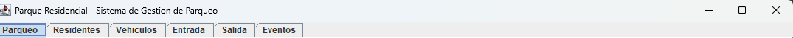
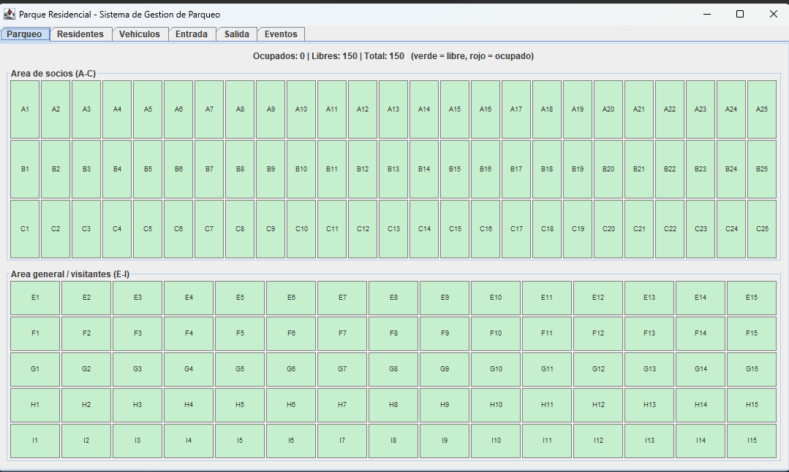
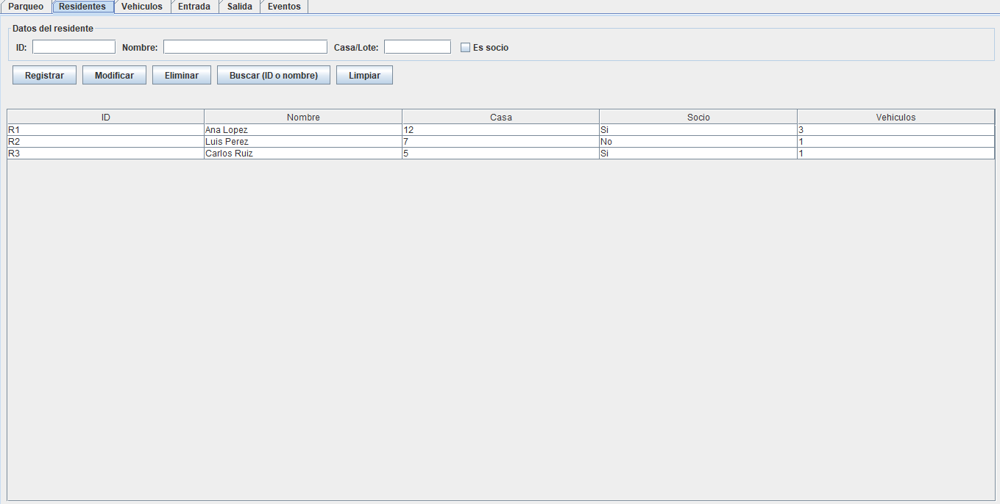
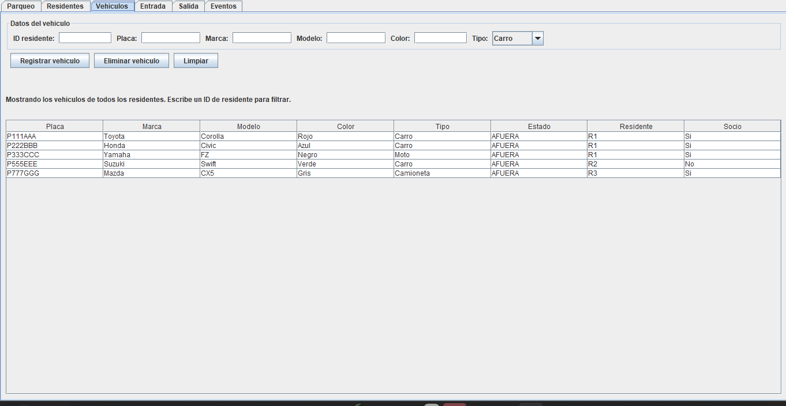
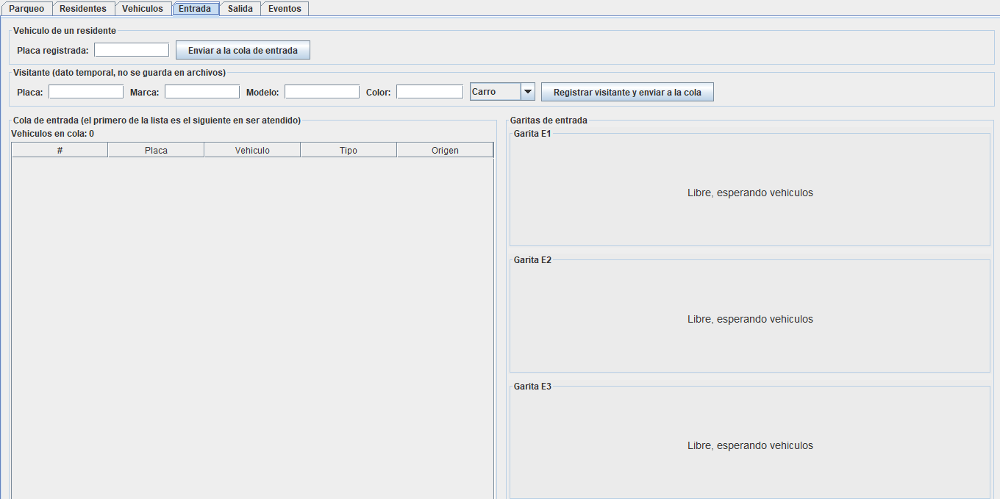
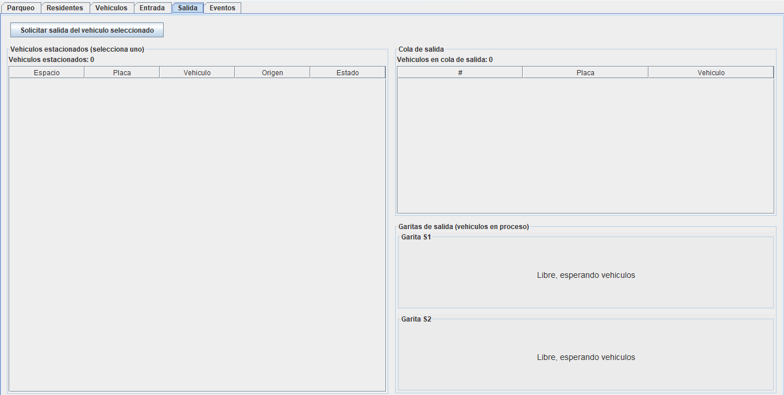
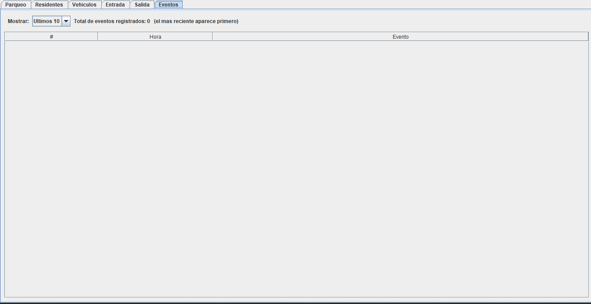
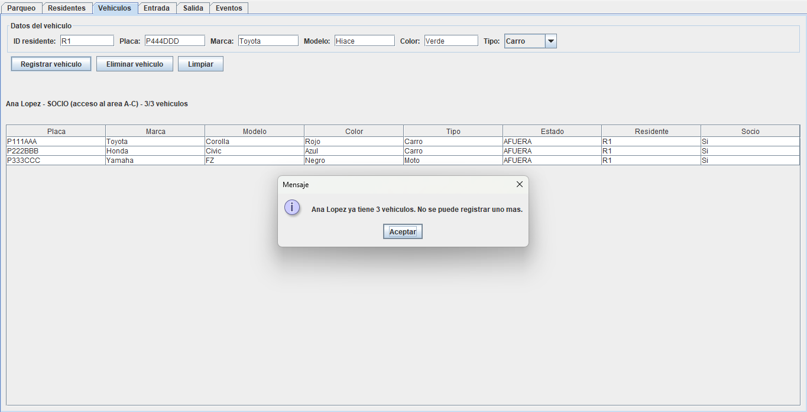

# Manual de Usuario - Parque Residencial

Pablo Adrian Mazariegos Ruiz 202402337

## 1. Requisitos e inicio

- Java JDK 17 o superior (se comprueba con `java -version`).
- Archivo `ParqueResidencial.jar` y, junto a él, la carpeta `data/` con `residentes.txt` y `vehiculos.txt`.

Para iniciar, abre una terminal en la carpeta del `.jar` y ejecuta:

`java -jar ParqueResidencial.jar`

Al abrir, el programa carga los residentes y vehículos guardados y arranca las cinco garitas (3 de entrada y 2 de salida).

## 2. Vista general

La ventana tiene seis pestañas: Parqueo, Residentes, Vehículos, Entrada, Salida y Eventos. La pestaña visible se actualiza sola cada medio segundo, así que no hay que refrescar nada.

> 

## 3. Pestaña Parqueo

Muestra los 150 espacios en filas. Las filas A, B y C (25 espacios) son del área de socios; E a I (15 espacios) son del área general. Un espacio libre se ve de un color y uno ocupado de otro, con la placa del vehículo. Arriba se indica cuántos espacios quedan libres.

> 

## 4. Pestaña Residentes

1. **Agregar:** escribe ID, nombre y número de casa, marca si es socio y pulsa Agregar. El ID no puede repetirse.
2. **Eliminar:** selecciona un residente de la tabla y pulsa Eliminar. También se eliminan sus vehículos.

No se puede usar el carácter `|` en ningún campo.

> 

## 5. Pestaña Vehículos

1. Elige el residente dueño.
2. Escribe placa, marca, modelo, color y tipo.
3. Pulsa Agregar. Cada residente puede tener hasta 3 vehículos y la placa no puede repetirse en todo el sistema.

Para quitar un vehículo, selecciónalo y pulsa Eliminar.

> 

## 6. Pestaña Entrada

Elige un vehículo de residente (o registra un visitante) y pulsa el botón de entrada. El vehículo pasa a la cola y una garita lo atiende en unos segundos. En la misma pestaña se ven las colas y lo que atiende cada garita, y se puede cambiar el tiempo de atención.

Un socio ocupa primero las filas A–C y, si están llenas, E–I. Los demás solo usan E–I.

> 

## 7. Pestaña Salida

La tabla lista los vehículos estacionados. Selecciona uno y pulsa Solicitar salida: pasa a la cola de salida y una de las dos garitas libera su espacio.

> 

## 8. Pestaña Eventos

Muestra el historial, con el evento más reciente arriba y la hora de cada uno: llegadas, atención de garitas, espacios asignados o liberados y rechazos.

> 

## 9. Mensajes de error comunes

| Mensaje | Causa | Qué hacer |
| --- | --- | --- |
| Parqueo lleno (rechazo) | No hay espacio para ese tipo de vehículo | Esperar a que salga alguno |
| Vehículo ya estacionado | Esa placa ya está dentro | Solicitar su salida primero |
| Residente ya existe / placa repetida | ID o placa duplicados | Usar un dato distinto |
| Límite de 3 vehículos | El residente ya tiene 3 | Eliminar uno antes |
| Campo con \` | \` | Carácter reservado del archivo |

> 

## 10. Cierre y datos guardados

Al cerrar la ventana, el programa guarda los residentes y vehículos en `data/residentes.txt` y `data/vehiculos.txt`, detiene las garitas y termina. Los vehículos estacionados en ese momento y los visitantes no se guardan: al volver a abrir, el parqueo está vacío.
